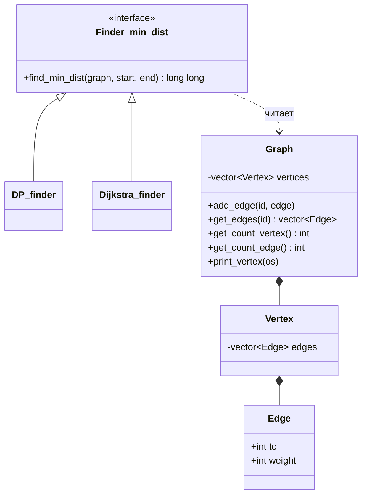

<div align="center">

# 🧭 dijkstra_dynamic_graph

**Кратчайшие пути в графе двумя способами: динамическое программирование и алгоритм Дейкстры.**
Единый интерфейс, взаимозаменяемые алгоритмы, чистая архитектура на современном C++.


[](https://github.com/meloy156/dijkstra_dynamic_graph/actions/workflows/ci.yml)


</div>

---

## 📑 Содержание

- [О проекте](#-о-проекте)
- [Возможности](#-возможности)
- [Алгоритмы](#-алгоритмы)
  - [Динамическое программирование](#1-динамическое-программирование-по-числу-рёбер)
  - [Алгоритм Дейкстры](#2-алгоритм-дейкстры)
  - [Сравнение](#сравнение)
- [Сложность](#-сложность)
- [Архитектура](#-архитектура)
- [Структура проекта](#-структура-проекта)
- [Сборка и запуск](#-сборка-и-запуск)
- [Пример использования](#-пример-использования)
- [Тесты и CI](#-тесты-и-ci)
- [Известные ограничения и планы](#-известные-ограничения-и-планы)
- [Лицензия](#-лицензия)

---

## 📖 О проекте

Учебный проект по курсу «Алгоритмы и структуры данных» (лабораторная работа по поиску кратчайших путей). Задача: найти минимальное расстояние между двумя вершинами взвешенного графа.

Главная идея репозитория: **граф отдельно, алгоритмы отдельно**. Оба алгоритма реализуют один интерфейс `Finder_min_dist`, поэтому их можно подставлять друг вместо друга, не трогая ни граф, ни клиентский код. Добавить третий алгоритм (Флойд, A\*, Беллман-Форд с детектором циклов) значит написать один новый класс.

## ✨ Возможности

- 🔹 Взвешенный граф на списках смежности (ориентированный; неориентированный строится добавлением обратных рёбер).
- 🔹 Два алгоритма поиска кратчайшего пути за общим интерфейсом.
- 🔹 Консольные приложения в диалоговом режиме: вводишь пару вершин, получаешь расстояние.
- 🔹 Распечатка графа (вершины, рёбра, их количество).
- 🔹 Результат `-1`, если пути не существует.

---

## 🧠 Алгоритмы

### 1. Динамическое программирование по числу рёбер

Метод строит ответ слоями: сначала лучшие пути, состоящие не более чем из одного ребра, затем не более чем из двух, и так далее. Рекуррентная формула:

```
f_i^(k+1) = min( f_i^(k),  min_j { f_j^(k) + S_ji } )
```

где `f_i^(k)`: лучшее известное расстояние от старта до вершины `i` путём не длиннее `k` рёбер, а `S_ji`: вес ребра `j → i`. Начальное условие: `f_start = 0`, остальные `= ∞`.

**Как это работает в коде** ([`DP_finder.cpp`](Algorithms/DP_finder.cpp)):

1. Заводится массив расстояний, все значения «бесконечность», у старта 0.
2. Выполняется до `V − 1` итераций. На каждой перебираются **все** достигнутые вершины и релаксируются все их рёбра.
3. Если за итерацию ничего не улучшилось, алгоритм останавливается досрочно: дальше считать нечего.
4. Ответ берётся из массива по индексу конечной вершины.

**Почему достаточно `V − 1` итераций.** Кратчайший путь без циклов проходит не более чем через `V` вершин, то есть содержит не более `V − 1` рёбер. После `k`-й итерации гарантированно найдены все оптимальные пути длины до `k` рёбер.

**Ключевое отличие от очереди с флагами.** Здесь вершины не «закрываются». Любое найденное улучшение распространяется дальше на следующей итерации. Поэтому метод корректен и при рёбрах отрицательного веса (но без отрицательных циклов).

### 2. Алгоритм Дейкстры

Жадный алгоритм: на каждом шаге берём ещё не раскрытую вершину с минимальным расстоянием и **навсегда фиксируем** его, так как при неотрицательных весах короче путь найти уже нельзя. Затем релаксируем рёбра этой вершины.

**Как это работает в коде** ([`Dijkstra_finder.cpp`](Algorithms/Dijkstra_finder.cpp)):

1. Массив расстояний («бесконечность», у старта 0) и массив флагов «вершина раскрыта».
2. Повторяем `V` раз: линейным проходом ищем нераскрытую вершину с наименьшим расстоянием.
3. Если такой нет (остальные недостижимы), выходим.
4. Помечаем вершину раскрытой и обновляем расстояния до её соседей.

Поиск минимума здесь простым перебором: это самая короткая и наглядная реализация, оптимальная для плотных графов.

### Сравнение

| | Динамическое программирование | Дейкстра |
|---|---|---|
| Идея | Слои по числу рёбер | Жадное раскрытие ближайшей вершины |
| Отрицательные веса | ✅ допустимы (без отрицательных циклов) | ❌ недопустимы |
| Вершина фиксируется | Нет, может улучшаться до конца | Да, один раз и навсегда |
| Досрочный выход | Если на итерации нет изменений | Если нет достижимых нераскрытых вершин |
| Когда лучше | Есть отрицательные веса, разреженный граф | Веса неотрицательные, нужна скорость |

---

## ⏱ Сложность

`V` число вершин, `E` число рёбер.

| Алгоритм | Время (худшее) | Время (лучшее) | Память |
|---|---|---|---|
| Динамическое программирование | `O(V · E)` | `O(E)`: сошлось за одну итерацию | `O(V)` |
| Дейкстра (массив, как в проекте) | `O(V² + E)` | `O(V² + E)` | `O(V)` |
| Дейкстра с бинарной кучей (план) | `O((V + E) log V)` | `O((V + E) log V)` | `O(V)` |

Память указана без учёта самого графа (он занимает `O(V + E)`).

---

## 🏗 Архитектура

Проект построен вокруг паттерна **«Стратегия»**: интерфейс `Finder_min_dist` задаёт контракт, а конкретные алгоритмы подменяются.



Принципы, на которых это держится:

- **Single Responsibility.** Граф хранит данные, алгоритмы считают, `main` общается с пользователем.
- **Open/Closed.** Новый алгоритм добавляется наследником, граф и существующие алгоритмы не меняются.
- **Dependency Inversion.** Клиентский код зависит от интерфейса `Finder_min_dist`, а не от конкретной реализации.
- Алгоритмы принимают граф по `const&` и не изменяют его.

---

## 📂 Структура проекта

```
dijkstra_dynamic_graph/
├── Graph/                       # Модель данных
│   ├── Graph.h                  #   Edge, Vertex, Graph
│   └── Graph.cpp
├── Algorithms/                  # Алгоритмы поиска кратчайшего пути
│   ├── Finder_min_dist.h        #   интерфейс (стратегия)
│   ├── DP_finder.h / .cpp       #   динамическое программирование
│   └── Dijkstra_finder.h / .cpp #   алгоритм Дейкстры
├── main/                        # Консольные приложения
│   ├── main_for_dynamic.cpp     #   демо: ДП, ориентированный граф (7 вершин)
│   └── main_for_dijkstra.cpp    #   демо: Дейкстра, неориентированный граф (8 вершин)
├── .github/workflows/ci.yml     # Сборка и проверки в CI
├── LICENSE
└── README.md
```

---

## 🚀 Сборка и запуск

**Требования:** компилятор с поддержкой C++17 (MSVC, MinGW-w64 g++) под Windows. Консольные демо используют `windows.h` для переключения кодировки консоли на UTF-8.

```bash
git clone https://github.com/meloy156/dijkstra_dynamic_graph.git
cd dijkstra_dynamic_graph

# Динамическое программирование
g++ -std=c++20 -O2 Graph/Graph.cpp Algorithms/DP_finder.cpp Apps/main_for_dynamic.cpp -o dp_app

# Алгоритм Дейкстры
g++ -std=c++20 -O2 Graph/Graph.cpp Algorithms/Dijkstra_finder.cpp Apps/main_for_dijkstra.cpp -o dijkstra_app
```

Запуск: `./dp_app` или `./dijkstra_app` (в Windows `dp_app.exe`).

---

## 💻 Пример использования

### В виде библиотеки

```cpp
#include "Graph/Graph.h"
#include "Algorithms/DP_finder.h"
#include "Algorithms/Dijkstra_finder.h"

int main() {
    Graph graph(4);                    // вершины нумеруются с 1
    graph.add_edge(1, {2, 10});        // ребро 1 -> 2, вес 10
    graph.add_edge(1, {3, 1});
    graph.add_edge(3, {2, 1});
    graph.add_edge(2, {4, 1});

    DP_finder dp;
    Dijkstra_finder dijkstra;

    // Оба алгоритма работают через один интерфейс
    const Finder_min_dist& finder = dp;
    std::cout << finder.find_min_dist(graph, 1, 4) << "\n";   // 3  (1 -> 3 -> 2 -> 4)
    std::cout << dijkstra.find_min_dist(graph, 1, 4) << "\n"; // 3
}
```

Если пути нет, возвращается `-1`.

### Консольное демо

Граф из задания (7 вершин, 11 ориентированных рёбер), запуск `dp_app`:

```
Расстояние от до: {id_от, id_до}
Выход: q
1 7
Итоговое расстояние: 18

Расстояние от до: {id_от, id_до}
Выход: q
7 1
Итоговое расстояние: -1
```

Кратчайший путь `1 → 7` равен 18 (через `1 → 3 → 2 → 4 → 7`), а из вершины 7 вершина 1 недостижима. Для графа `dijkstra_app` (8 вершин, неориентированный) расстояние `1 → 8` равно 11.

---

## ✅ Тесты и CI

| Проверка | Статус | Что проверяет |
|---|---|---|
| Сборка (CI) | [](https://github.com/meloy156/dijkstra_dynamic_graph/actions/workflows/ci.yml) | Компиляция обоих приложений без ошибок и предупреждений |
| Тесты алгоритмов | [](https://github.com/meloy156/dijkstra_dynamic_graph/actions/workflows/ci.yml) | Известные расстояния на графах из задания, недостижимые вершины, совпадение ДП и Дейкстры |

Нажми на значок, чтобы открыть последний запуск в GitHub Actions.

---

## 🛠 Известные ограничения и планы

Честный список того, что ещё предстоит улучшить:

- [ ] Проверка корректности номеров вершин (сейчас выход за границы не обрабатывается).
- [ ] Детектор отрицательных циклов в ДП (`V`-я итерация, которая что-то меняет).
- [ ] Дейкстра на бинарной куче (`std::priority_queue`): `O((V + E) log V)`.
- [ ] Восстановление самого маршрута, а не только его длины (массив предков).
- [ ] Бесконечность через `std::numeric_limits<long long>::max() / 2` вместо `INT_MAX`.
- [ ] Возврат `std::optional` вместо `-1` как признака «пути нет».
- [ ] Чтение графа из файла, замеры времени выполнения.
- [ ] Кроссплатформенные демо.

---

## 📄 Лицензия

Проект распространяется под лицензией **MIT**. Подробности в файле [LICENSE](LICENSE).
